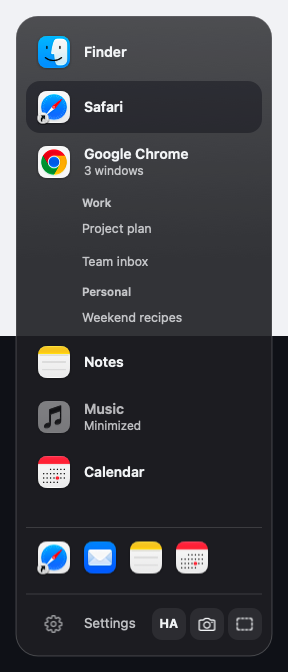
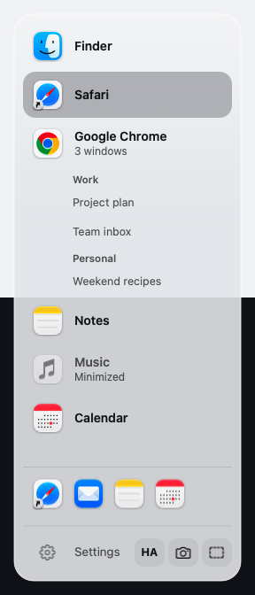
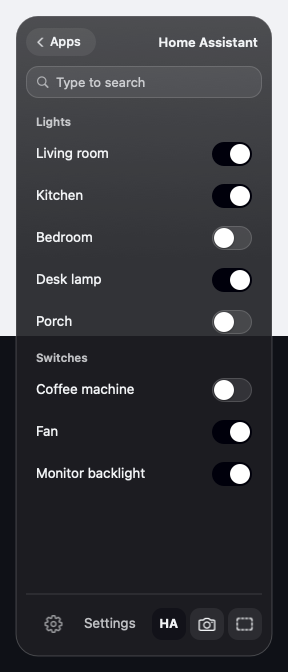
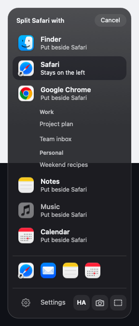
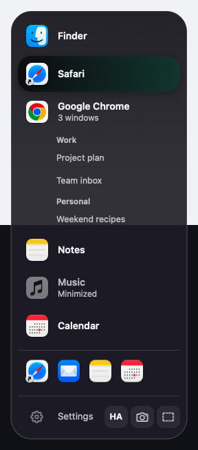
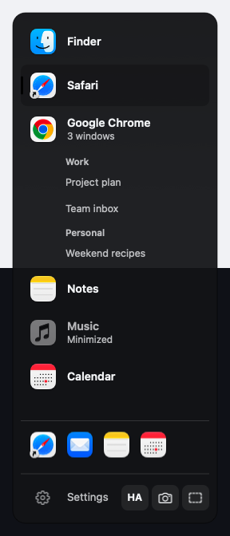
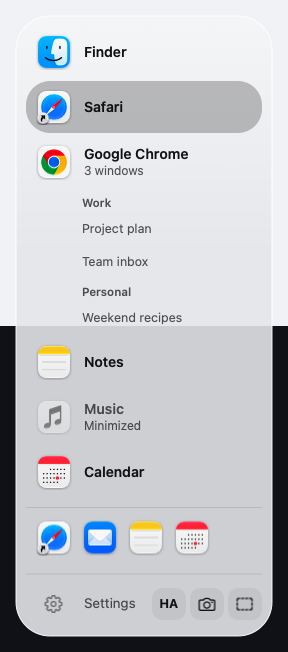
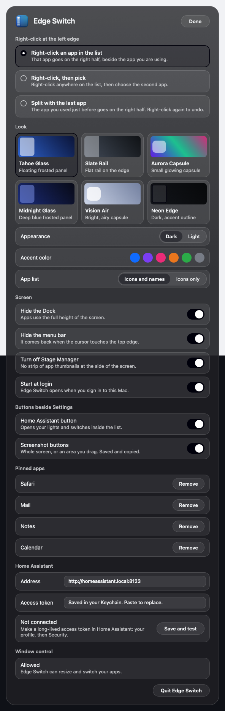

# Edge Switch

A simple app switcher for macOS, for anyone who finds Stage Manager and the Dock in the way.

- Every app fills the screen as soon as it opens. No extra click.
- Move the cursor to the left edge of the screen: a list of your open apps slides out. Click one to switch.
- Right-click an app in the list to put two apps side by side, 50/50.
- The Dock and the menu bar stay hidden, so apps get the whole screen.

<p>
  
  
  
</p>

## Download and install

**[Download the latest release](../../releases/latest)** (macOS 14 Sonoma or later, Apple silicon or Intel).

### Easiest: the installer

1. On the releases page, download **Edge-Switch-x.y.z.dmg**.
2. Open it and drag **Edge Switch** onto the **Applications** folder.
3. Open Edge Switch from Applications (or Launchpad).
4. The first time, macOS may say it cannot check the app, because it is not from the App Store. Click **Done**, then open **System Settings > Privacy & Security**, scroll down and click **Open Anyway** next to Edge Switch. You only do this once.
5. When asked, switch on **Edge Switch** in **System Settings > Privacy & Security > Accessibility**. This lets it resize and arrange your windows.

That's it. Edge Switch has no Dock icon; it lives at the left edge of your screen.

### One line in Terminal

Paste this into Terminal and press Return. It downloads the latest release, puts it in Applications and starts it, without the "cannot check the app" step:

```bash
curl -fsSL https://raw.githubusercontent.com/easter478/apple-edge-switch/main/install.sh | zsh
```

### Uninstall

Quit Edge Switch (Settings > Quit Edge Switch; it puts the Dock, menu bar and Stage Manager back as they were) and move it from Applications to the Trash.

## Using it

| Do this | What happens |
|---|---|
| Touch the left edge with the cursor | The list of open apps slides out |
| Click an app | Switches to it, filling the screen |
| Right-click an app | Puts it on the right half, beside the app you are using |
| Click a window under an app | Jumps to that window (Chrome windows are grouped by profile) |
| Pin button on an app | Keeps it in the pinned row, even when closed |
| x / – on an app | Quit it / hide it |
| HA button | Your Home Assistant lights and switches |
| Camera / dashed square | Screenshot of the whole screen / of an area you drag |
| Settings | Looks, split style, Dock and menu bar, pinned apps, Home Assistant |

Three split styles are in Settings: right-click an app, right-click then pick, or split with the last app you used.

<p>
  
  
  
  
</p>



Six looks (Tahoe Glass, Slate Rail, Aurora Capsule, Midnight Glass, Vision Air, Neon Edge), each in dark and light, with six accent colours. The design rules are in [THEME.md](THEME.md).

### Home Assistant

In Settings, enter your Home Assistant address (for example `http://homeassistant.local:8123`) and a long-lived access token (in Home Assistant: your profile > Security), then click **Save and test**. The token is stored in the macOS Keychain, never in a file.

### Permissions it asks for

- **Accessibility**: to move and resize other apps' windows. Required.
- **Screen Recording**: only if you use the screenshot buttons.
- **Local network**: only if you use Home Assistant.

## Technologies

- Swift, AppKit (no SwiftUI), no third-party libraries.
- macOS Accessibility API (`AXUIElement`, `AXObserver`) to move, resize and raise windows.
- `NSVisualEffectView` for the frosted glass.
- `ServiceManagement` for Start at login.
- Home Assistant REST API; macOS Keychain for the token.
- `screencapture` for screenshots.
- Built with `swiftc` and a shell script. No Xcode project needed.

## Build, run and test

Needs the Xcode Command Line Tools (`xcode-select --install`).

Build, install to `~/Applications` and start:

```bash
./build.sh
```

Build and install without starting, or build only:

```bash
./build.sh --no-run
```

```bash
./build.sh --no-install
```

Self-built copies are signed ad hoc, so macOS treats every rebuild as a new app: switch Accessibility on again after each build.

Check what the app sees from Terminal:

```bash
"$HOME/Applications/Edge Switch.app/Contents/MacOS/EdgeSwitch" --cli status
```

Other checks: `--cli fill <app>`, `--cli split <left app> <right app>`, `--cli tweaks`, `--cli ha`.

Render the list or Settings to a picture (the README screenshots are made this way, with sample data):

```bash
"$HOME/Applications/Edge Switch.app/Contents/MacOS/EdgeSwitch" --snapshot panel list.png tahoe dark names blue demo
```

Kinds: `panel`, `panel-pick`, `panel-home`, `settings`. Leave out `demo` to show your own apps.

## Releases

Each version is published on the [Releases page](../../releases) with:

- `Edge-Switch-<version>.dmg`: drag-to-Applications installer (recommended)
- `Edge-Switch-<version>.zip`: the app on its own (used by the Terminal installer)
- `Edge-Switch-<version>.sha256`: checksums

How a release is made:

1. Set `VERSION` in `build.sh` and add a `## <version>` section to [CHANGELOG.md](CHANGELOG.md).
2. Commit and push.
3. Run `./release.sh --publish`. It builds a universal app (Apple silicon and Intel), makes the DMG, zip and checksums in `dist/`, tags `v<version>` and creates the GitHub release with that version's changelog as the notes.

Run `./release.sh` without `--publish` to make the files locally without publishing.

## How it works

- `Sources/main.swift`: start-up; runs as a background app with no Dock icon.
- `Sources/AppModel.swift`: open apps, windows, the app in use, split state, pinned apps.
- `Sources/WindowControl.swift`: Accessibility calls that fill, split, focus and close windows.
- `Sources/Panel.swift`: the edge list and its slide in and out.
- `Sources/SettingsWindow.swift`: the Settings sheet.
- `Sources/SystemTweaks.swift`: Dock, menu bar and Stage Manager settings, restored on quit.
- `Sources/HomeAssistant.swift`, `Sources/Screenshots.swift`: the tool buttons.
- `Sources/Theme.swift`: every colour and size for the six looks.
- `Sources/Tools.swift`: app icon, snapshots and the `--cli` checks.

## Changelog

See [CHANGELOG.md](CHANGELOG.md).
